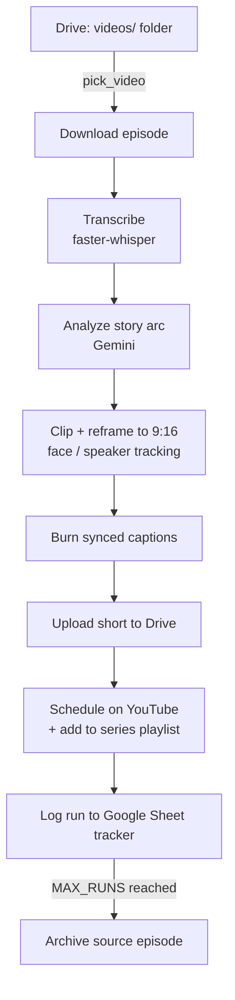

# shortgen-himym

Automated pipeline that turns full *How I Met Your Mother* episodes into story-driven YouTube Shorts. Picks an unprocessed episode, transcribes it, finds the best multi-clip story arc with Gemini, stitches a vertical "short" with face-tracked reframing and synced captions, and publishes it to YouTube on a schedule.

## How it works

1. **Pick** — `drive_client.pick_video` selects the next un-processed episode from a Google Drive `videos/` folder, tracked via a Google Sheet (`sheet_tracker.SheetTracker`) so each episode is reused up to `MAX_RUNS` times without repeating segments.
2. **Transcribe** — `transcriber.transcribe_video` runs `faster-whisper` to get word- and segment-level timestamps.
3. **Analyze** — `analyzer.analyze_transcript` sends the transcript to Gemini to find the best story arc (multiple clips forming one storyline), avoiding previously used segments, and also generates YouTube title/description/tags.
4. **Clip** — `clipper.create_story_short` cuts the selected segments, reframes each to vertical 9:16 using face detection (and optional speaker diarization via `pyannote.audio` for speaker-aware framing), and burns in synced captions.
5. **Publish** — the short is uploaded to Google Drive, then scheduled on YouTube (`youtube_client.upload_scheduled`) and added to a series-specific playlist. The run is logged back to the tracker sheet, and the source episode is archived once `MAX_RUNS` is reached.



## Architecture

| File | Role |
|---|---|
| `src/main.py` | Orchestrates the full pipeline end to end |
| `src/drive_client.py` | Google Drive download/upload, video picking, archiving |
| `src/transcriber.py` | Whisper-based transcription |
| `src/analyzer.py` | Gemini story-arc selection + YouTube metadata generation |
| `src/clipper.py` | Clip extraction, reframing, caption burn-in |
| `src/reframer.py` | Face/speaker-aware vertical reframing |
| `src/sheet_tracker.py` | Google Sheets-based run/segment tracker |
| `src/youtube_client.py` | Scheduled YouTube upload + playlist management |

## Setup

```bash
pip install -r requirements.txt
python setup_oauth.py      # Drive OAuth
python setup_yt_oauth.py   # YouTube OAuth
python src/main.py
```

Requires `GOOGLE_SERVICE_ACCOUNT_JSON`, `GEMINI_API_KEY`, `SPREADSHEET_ID` env vars (`HF_TOKEN` optional, enables speaker diarization).
